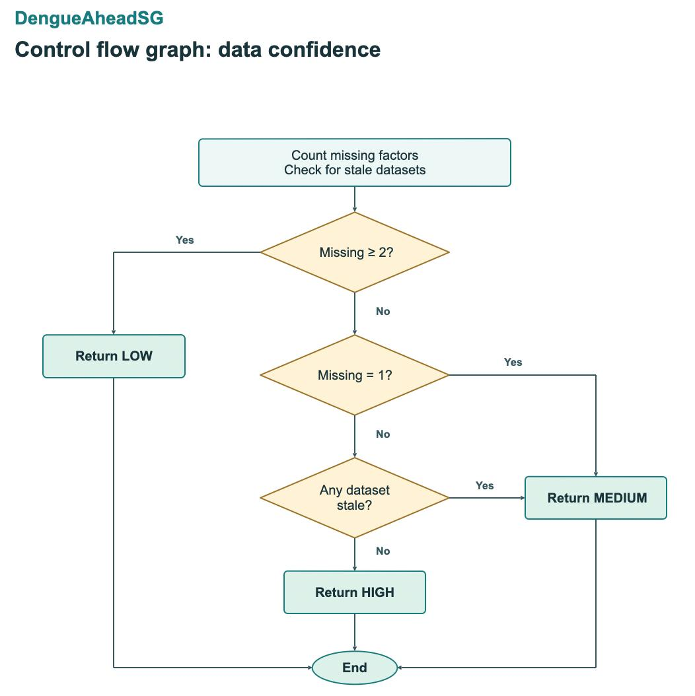
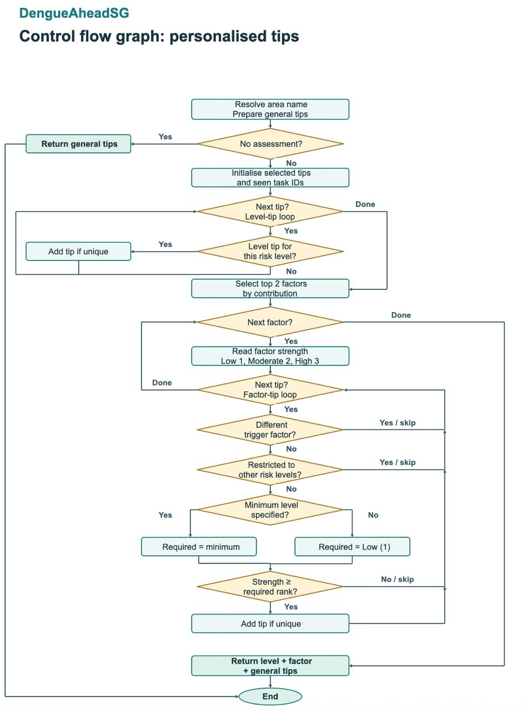

# DengueAheadSG Lab 4 test design

Ticket #37: Romeo. Includes Huajia’s risk assessment cases from #25.

**Reference:** Lab 4 §3.2. **Code checked:** `master` at `7d7b749`. **Local verification:** 5 November 2026, Singapore time.

The black-box tables test representative input groups and their limits. The white-box tables follow individual True and False paths in the code. The test IDs connect each diagram to the inputs and expected results.

## Verification summary

The tables keep the 98 cases from the team draft and add DC-X2, the reduced-calculator case requested in #37. The actual outputs come from local checks with fixed inputs and prepared responses for location and data services.

| Area | Designed | Passed | Failed |
| --- | --- | --- | --- |
| Risk assessment | 22 | 22 | 0 |
| Risk simulation | 25 | 25 | 0 |
| Location search | 12 | 12 | 0 |
| Risk map | 10 | 10 | 0 |
| Prevention checklist | 5 | 5 | 0 |
| Data confidence | 6 | 5 | 1 |
| Personalised tips | 19 | 19 | 0 |
| Total | 99 | 98 | 1 |

**Finding DC-X2:** with two of the five model calculators configured and both returning a result, the current implementation returns **HIGH** confidence. The #39 finding expects **LOW**, because three model factors are absent. The current code subtracts the returned contribution count from the configured calculator count, so it counts zero missing. The table preserves the failed result for review.

**Existing automated suite:** `npm test -- --reporter=dot` passed **419 tests in 34 files** on the same revision. These are the existing automated tests. The 99 rows below report the separate local check, including the reduced-configuration case.

## Black-box test cases

Equivalence class partitioning (ECP) selects one example from a group of inputs that should behave alike. Boundary value analysis (BVA) tests the values at or around a limit.

### RiskAssessmentControl · UC-1, UC-2, UC-4

Risk bands start at 25, 50 and 75. The normal assessment path caps the total to 0–100 and rounds to one decimal place before classification. The direct classification calls at −1 and 101 document how the method behaves when called outside that range.

| Test ID | Test input | Class or boundary | Expected output | Actual output | Result |
| --- | --- | --- | --- | --- | --- |
| RA-ECP-01 | Risk index 10 | Low class | LOW | LOW | Pass |
| RA-ECP-02 | Risk index 35 | Moderate class | MODERATE | MODERATE | Pass |
| RA-ECP-03 | Risk index 60 | High class | HIGH | HIGH | Pass |
| RA-ECP-04 | Risk index 85 | Very High class | VERY_HIGH | VERY_HIGH | Pass |
| RA-ECP-05 | Risk index −1 | Below the valid range | LOW | LOW | Pass |
| RA-ECP-06 | Risk index 101 | Above the valid range | VERY_HIGH | VERY_HIGH | Pass |
| RA-BVA-01 | 0 | Lowest valid value | LOW | LOW | Pass |
| RA-BVA-02 | 24.9 | Just below Moderate | LOW | LOW | Pass |
| RA-BVA-03 | 25 | Start of Moderate | MODERATE | MODERATE | Pass |
| RA-BVA-04 | 49.9 | Just below High | MODERATE | MODERATE | Pass |
| RA-BVA-05 | 50 | Start of High | HIGH | HIGH | Pass |
| RA-BVA-06 | 74.9 | Just below Very High | HIGH | HIGH | Pass |
| RA-BVA-07 | 75 | Start of Very High | VERY_HIGH | VERY_HIGH | Pass |
| RA-BVA-08 | 100 | Highest valid value | VERY_HIGH | VERY_HIGH | Pass |
| RA-ECP-07 | Factor points adding up to 120 | Total above 100 | 100 | 100 | Pass |
| RA-ECP-08 | Factor points adding up to −5 | Total below 0 | 0 | 0 | Pass |
| RA-ECP-09 | Factor points 20.04 + 35.5 | Rounding | 55.5 | 55.5 | Pass |
| RA-ECP-10 | Teck Whye test area. All five calculators return a score of 60 and datasets are fresh. | Complete assessment | 5 factors, index 60, HIGH risk, HIGH confidence | 5 factors, index 60, HIGH risk, HIGH confidence | Pass |
| RA-ECP-11 | Generate an assessment for an unknown area ID. | Unknown area | No assessment (`null`) | No assessment (`null`) | Pass |
| RA-ECP-12 | Mark the dengue-cluster dataset FAILED. | Core dataset failed | No assessment (`null`) | No assessment (`null`) | Pass |
| RA-ECP-13 | The dengue-cluster calculator returns no value. | Core factor missing | No assessment (`null`) | No assessment (`null`) | Pass |
| RA-ECP-14 | Humidity is unavailable. Each of the other four calculators returns 60. | Optional factor missing and weights redistributed | 4 factors, index 60, contributions total 60 | 4 factors, index 60, contributions total 60 | Pass |

The risk-level classification cases reuse [ticket #25’s design](../../dengue-ahead-sg/docs/black-box-test-design.md). The current parameterised test includes the exact representative values 10, 35, 60 and 85, the six band boundaries, 0 and 100, and the direct inputs −1 and 101.

### RiskSimulationControl · UC-4

An adjustment accepts either a preset or an exact value. Humidity uses percent and rainfall uses millimetres. High-Aedes overlap uses a **ratio from 0 to 1 in the control** and a **percentage from 0 to 100 on screen**. For example, 25% is passed as `0.25`. The control rejects `1.01` because it represents 101%.

| Test ID | Test input | Class or boundary | Expected output | Actual output | Result |
| --- | --- | --- | --- | --- | --- |
| SIM-ECP-01 | Humidity, preset "Increase" | Valid preset | Accepted (`true`) | Accepted (`true`) | Pass |
| SIM-ECP-02 | Population density, preset "Increase" | Factor that can't be adjusted | Rejected (`false`) | Rejected (`false`) | Pass |
| SIM-ECP-03 | Humidity, preset "HUGE" | Unknown preset | Rejected (`false`) | Rejected (`false`) | Pass |
| SIM-ECP-04 | Humidity, value 80 | Valid exact value | Accepted (`true`) | Accepted (`true`) | Pass |
| SIM-ECP-05 | Humidity, value 80 and preset "Increase" | Both given | Rejected (`false`) | Rejected (`false`) | Pass |
| SIM-ECP-06 | Humidity, value "not a number" | Not a number | Rejected (`false`) | Rejected (`false`) | Pass |
| SIM-ECP-07 | Rainfall, value 5000 mm | Very large rainfall | Accepted (`true`) | Accepted (`true`) | Pass |
| SIM-ECP-08 | Pass `null` as the adjustment. | Missing adjustment object | Rejected (`false`) | Rejected (`false`) | Pass |
| SIM-BVA-01 | Humidity −0.1 | Just below 0 | Rejected (`false`) | Rejected (`false`) | Pass |
| SIM-BVA-02 | Humidity 0 | Lower limit | Accepted (`true`) | Accepted (`true`) | Pass |
| SIM-BVA-03 | Humidity 100 | Upper limit | Accepted (`true`) | Accepted (`true`) | Pass |
| SIM-BVA-04 | Humidity 100.1 | Just above 100 | Rejected (`false`) | Rejected (`false`) | Pass |
| SIM-BVA-05 | High-Aedes overlap 0 | Lower limit | Accepted (`true`) | Accepted (`true`) | Pass |
| SIM-BVA-06 | High-Aedes overlap 1 (100 %) | Upper limit | Accepted (`true`) | Accepted (`true`) | Pass |
| SIM-BVA-07 | High-Aedes overlap 1.01 | Just above 100 % | Rejected (`false`) | Rejected (`false`) | Pass |
| SIM-BVA-08 | Rainfall −0.1 mm | Just below 0 | Rejected (`false`) | Rejected (`false`) | Pass |
| SIM-BVA-09 | Rainfall 0 mm | Lower limit | Accepted (`true`) | Accepted (`true`) | Pass |

| Test ID | Test input | Expected output | Actual output | Result |
| --- | --- | --- | --- | --- |
| SIM-CLAMP-01 | 99% humidity, normal SD 3 percentage points, Large increase. | 100% | 100% | Pass |
| SIM-CLAMP-02 | 10 mm rainfall, normal SD 20 mm, Large decrease. | 0 mm | 0 mm | Pass |
| SIM-CLAMP-03 | Area overlap 0, second area overlap 0.2, Large decrease. | 0 ratio | 0 ratio | Pass |
| SIM-CLAMP-04 | Current humidity 77.3%, No change. | 77.3% | 77.3% | Pass |
| SIM-REC-01 | Set Teck Whye fixture humidity to 95%. Check the simulated assessment and its humidity input. | SIMULATED with 95% humidity input | SIMULATED with 95% humidity input | Pass |
| SIM-REC-02 | Set humidity to 95% and compare the original assessment and snapshot with copies taken before simulation. | Unchanged | Unchanged | Pass |
| SIM-REC-03 | Set humidity to 80% and 90% in the same scenario. | Duplicate simulation factor | Duplicate simulation factor | Pass |
| SIM-REC-04 | Set humidity to 120%. | Invalid simulation adjustment | Invalid simulation adjustment | Pass |

### LocationRiskControl · UC-1, UC-5

The location fixture supplies a Teck Whye area and a prepared geocoder response. A six-digit query is a postal code. Text longer than 200 characters after trimming is rejected before geocoding.

| Test ID | Test input | Class or boundary | Expected output | Actual output | Result |
| --- | --- | --- | --- | --- | --- |
| LOC-ECP-01 | 680123 | Valid postal code | OK, TECK WHYE, POSTAL_CODE | OK, TECK WHYE, POSTAL_CODE | Pass |
| LOC-ECP-02 | Teck Whye Lane | Valid address | OK, TECK WHYE, ADDRESS | OK, TECK WHYE, ADDRESS | Pass |
| LOC-ECP-03 | asdfgh | No such place | INVALID_LOCATION, INVALID | INVALID_LOCATION, INVALID | Pass |
| LOC-ECP-04 | Johor Bahru | Outside Singapore | INVALID_LOCATION, OUTSIDE_SINGAPORE | INVALID_LOCATION, OUTSIDE_SINGAPORE | Pass |
| LOC-ECP-05 | Search 680123 and make the geocoder fail. | Search service unavailable | DATA_UNAVAILABLE, Location search is unavailable. | DATA_UNAVAILABLE, Location search is unavailable. | Pass |
| LOC-ECP-06 | Geocoder returns a point within the accepted Singapore bounds but outside the supplied subzone. | No matching subzone | DATA_UNAVAILABLE, Area data unavailable for this location. | DATA_UNAVAILABLE, Area data unavailable for this location. | Pass |
| LOC-ECP-07 | Search 680123 and make snapshot retrieval fail. | Public data unavailable | DATA_UNAVAILABLE, Public data could not be loaded. | DATA_UNAVAILABLE, Public data could not be loaded. | Pass |
| LOC-ECP-08 | Search 680123 with no data service connected. | Missing service | DATA_UNAVAILABLE, Risk data services are not connected yet. | DATA_UNAVAILABLE, Risk data services are not connected yet. | Pass |
| LOC-BVA-01 | Empty text | Length 0 | INVALID_LOCATION, INVALID | INVALID_LOCATION, INVALID | Pass |
| LOC-BVA-02 | Spaces only | Blank after trimming | INVALID_LOCATION, INVALID | INVALID_LOCATION, INVALID | Pass |
| LOC-BVA-03 | Submit 200 characters with a successful prepared geocoder reply. | Maximum accepted length | OK, TECK WHYE, ADDRESS | OK, TECK WHYE, ADDRESS | Pass |
| LOC-BVA-04 | Submit 201 characters. | Just beyond the limit | INVALID_LOCATION, INVALID | INVALID_LOCATION, INVALID | Pass |

### RiskMapControl · UC-2

The map fixture supplies named subzones and known risk indices. It covers map loading, valid assessments, ranking, ties, area selection and independent overlay toggles.

| Test ID | Test input | Class or boundary | Expected output | Actual output | Result |
| --- | --- | --- | --- | --- | --- |
| MAP-ECP-01 | Supply three subzones and one valid assessment for each. | Available map data | OK, 3 areas, 3 risk levels | OK, 3 areas, 3 risk levels | Pass |
| MAP-ECP-02 | Make snapshot retrieval fail. | Unavailable data | DATA_UNAVAILABLE | DATA_UNAVAILABLE | Pass |
| MAP-ECP-03 | Load a snapshot with zero subzones. | Empty map | DATA_UNAVAILABLE | DATA_UNAVAILABLE | Pass |
| MAP-ECP-04 | Rank twelve assessments with indices 1 through 12. | Descending top-ten ranking | 12, 11, 10, 9, 8, 7, 6, 5, 4, 3 | 12, 11, 10, 9, 8, 7, 6, 5, 4, 3 | Pass |
| MAP-ECP-05 | Supply areas 02 and 01 in that order with the same score. | Tie broken by area ID | 01, 02 | 01, 02 | Pass |
| MAP-ECP-06 | Select an area ID absent from the supplied subzones. | Unknown area | No selection (`null`) | No selection (`null`) | Pass |
| MAP-ECP-07 | Supply factor contributions of 1, 8, 3 and 7 points. | Three largest contributions | 8, 7, 3 | 8, 7, 3 | Pass |
| MAP-ECP-08 | Clusters off and high-Aedes on. Toggle the cluster layer. | Independent overlay state | Clusters on, high-Aedes on | Clusters on, high-Aedes on | Pass |
| MAP-BVA-01 | Three assessed areas and one unassessed area. | Exclude the unassessed area | 3 | 3 | Pass |
| MAP-BVA-02 | One area exists but it has no assessment. | Zero ranked areas | 0 | 0 | Pass |

### PreventionGuidanceControl · UC-3

Use the bundled checklist for the valid cases. Supply an empty checklist to test unavailable guidance. The empty task ID checks the input edge for looking up details.

| Test ID | Test input | Class or boundary | Expected output | Actual output | Result |
| --- | --- | --- | --- | --- | --- |
| PG-ECP-01 | Load the bundled NEA checklist. | Tasks available | 15 | 15 | Pass |
| PG-ECP-02 | Load a custom checklist with zero tasks. | Empty checklist | Prevention guidance is currently unavailable. | Prevention guidance is currently unavailable. | Pass |
| PG-ECP-03 | Open known task ID `tip_gen_block_1`. | Known ID with a source | tip_gen_block_1 with an NEA link | tip_gen_block_1 with an NEA link | Pass |
| PG-ECP-04 | Open an unknown task ID. | Unknown ID | No task (`null`) | No task (`null`) | Pass |
| PG-BVA-01 | Open a task with an empty ID. | Empty input | No task (`null`) | No task (`null`) | Pass |

## White-box basis paths

### Data confidence · determineDataConfidence

Start with five configured calculators unless the case says otherwise. A missing input is represented by a calculator returning no result. The `missing = 1` check and the stale-data check are separate graph decisions, because either can produce Medium confidence.

The graph has **8 nodes** and **10 edges**, so `V(G) = E − N + 2 = 4`. The table follows the Yes and No arrows in the diagram. Yes means True and No means False.

| Test ID | Route |
| --- | --- |
| DC-P1 | Missing ≥ 2 (Yes) → LOW |
| DC-P2 | Missing ≥ 2 (No) → Missing = 1 (Yes) → MEDIUM |
| DC-P3 | Missing ≥ 2 (No) → Missing = 1 (No) → Any dataset stale (Yes) → MEDIUM |
| DC-P4 | Missing ≥ 2 (No) → Missing = 1 (No) → Any dataset stale (No) → HIGH |

| Test ID | Test input | Expected output | Actual output | Result |
| --- | --- | --- | --- | --- |
| DC-P1 | Five configured. Humidity and rainfall return no result. Datasets fresh. | 3 contributions, LOW confidence | 3 contributions, LOW confidence | Pass |
| DC-P2 | Five configured. Only humidity returns no result. Datasets fresh. | 4 contributions, MEDIUM confidence | 4 contributions, MEDIUM confidence | Pass |
| DC-P3 | All five return results. Mark high-Aedes data STALE. | 5 contributions, MEDIUM confidence | 5 contributions, MEDIUM confidence | Pass |
| DC-P4 | All five return results. All dataset statuses FRESH. | 5 contributions, HIGH confidence | 5 contributions, HIGH confidence | Pass |
| DC-X1 | Five configured. Humidity and rainfall return no result and high-Aedes data is STALE. Same route as DC-P1. | 3 contributions, LOW confidence | 3 contributions, LOW confidence | Pass |
| DC-X2 | Configure only dengue-cluster and humidity calculators. Both return results and all datasets are fresh. The current code takes the DC-P4 route. | 2 contributions, LOW confidence | 2 contributions, HIGH confidence | Fail |

### Personalised tips · generateTips

The step and edge table numbers the boxes and diamonds in the Lab 5 diagram. Yes means True, and No or Done means False. The diagram shows each combined risk-level check as one decision. The extra cases check duplicate tips and local text.

The graph has **20 nodes** and **28 edges**. With one connected graph, `V(G) = E − N + 2 = 10`. The 10 routes below are independent. T means True and F means False.

| Node | Step | Outgoing edges |
| --- | --- | --- |
| 1 | Resolve area name and prepare general tips | 2 |
| 2 | No assessment? | True → 3 · False → 4 |
| 3 | Return general tips | E |
| 4 | Initialise selected tips and seen task IDs | 5 |
| 5 | Next tip in level-tip loop? | True → 6 · False → 8 |
| 6 | Level tip for this risk level? | True → 7 · False → 5 |
| 7 | Add tip if unique | 5 |
| 8 | Select top 2 factors by contribution | 9 |
| 9 | Next factor? | True → 10 · False → 17 |
| 10 | Read factor strength | 11 |
| 11 | Next tip in factor-tip loop? | True → 12 · False → 9 |
| 12 | Different trigger factor? | True → 11 · False → 13 |
| 13 | Restricted to other risk levels? | True → 11 · False → 14 |
| 14 | Minimum level specified? | True → 14a · False → 14b |
| 14a | Required = minimum | 15 |
| 14b | Required = Low (1) | 15 |
| 15 | Strength ≥ required rank? | True → 16 · False → 11 |
| 16 | Add tip if unique | 11 |
| 17 | Return level + factor + general tips | E |
| E | End | Exit |

| Test ID | Complete route |
| --- | --- |
| GT-P1 | 1 → 2T → 3 → E |
| GT-P2 | 1 → 2F → 4 → 5F → 8 → 9F → 17 → E |
| GT-P3 | 1 → 2F → 4 → 5T → 6T → 7 → 5F → 8 → 9F → 17 → E |
| GT-P4 | 1 → 2F → 4 → 5T → 6F → 5F → 8 → 9F → 17 → E |
| GT-P5 | 1 → 2F → 4 → 5F → 8 → 9T → 10 → 11F → 9F → 17 → E |
| GT-P6 | 1 → 2F → 4 → 5T → 6F → 5F → 8 → 9T → 10 → 11T → 12T → 11F → 9F → 17 → E |
| GT-P7 | 1 → 2F → 4 → 5T → 6F → 5F → 8 → 9T → 10 → 11T → 12F → 13T → 11F → 9F → 17 → E |
| GT-P8 | 1 → 2F → 4 → 5T → 6F → 5F → 8 → 9T → 10 → 11T → 12F → 13F → 14T → 14a → 15F → 11F → 9F → 17 → E |
| GT-P9 | 1 → 2F → 4 → 5T → 6F → 5F → 8 → 9T → 10 → 11T → 12F → 13F → 14F → 14b → 15T → 16 → 11F → 9F → 17 → E |
| GT-P10 | 1 → 2F → 4 → 5T → 6F → 5F → 8 → 9T → 10 → 11T → 12F → 13F → 14T → 14a → 15T → 16 → 11F → 9F → 17 → E |

The tests use a small checklist. `G` is a general tip, `L` is a risk-level tip and `F` is a factor tip. A factor’s contribution rank is Low = 1, Moderate = 2 or High = 3.

| Test ID | Test input | Expected output | Actual output | Result |
| --- | --- | --- | --- | --- |
| GT-P1 | Checklist: G1. Assessment: None. | G1 | G1 | Pass |
| GT-P2 | Checklist: (none). Assessment: HIGH, no factors. | No tips (`[]`) | No tips (`[]`) | Pass |
| GT-P3 | Checklist: L1 (for HIGH). Assessment: HIGH. | L1 | L1 | Pass |
| GT-P4 | Checklist: L1 (for LOW). Assessment: HIGH. | No tips (`[]`) | No tips (`[]`) | Pass |
| GT-P5 | Checklist: (none). Assessment: HIGH; top factor Aedes (High). | No tips (`[]`) | No tips (`[]`) | Pass |
| GT-P6 | Checklist: F1 (for clusters). Assessment: HIGH; top factor Aedes (High). | No tips (`[]`) | No tips (`[]`) | Pass |
| GT-P7 | Checklist: F1 (for Aedes, LOW risk only). Assessment: HIGH; top factor Aedes (High). | No tips (`[]`) | No tips (`[]`) | Pass |
| GT-P8 | Checklist: F1 (for Aedes, needs High). Assessment: HIGH; top factor Aedes (**Moderate**). | No tips (`[]`) | No tips (`[]`) | Pass |
| GT-P9 | Checklist: F1 (for Aedes, no minimum). Assessment: HIGH; top factor Aedes (Low). | F1 | F1 | Pass |
| GT-P10 | Checklist: F1 (for Aedes, needs High). Assessment: HIGH; top factor Aedes (High). | F1 | F1 | Pass |
| GT-X1 | G1, L1 (HIGH), F1 (Aedes); HIGH; Aedes top | L1, F1, G1 | L1, F1, G1 | Pass |
| GT-X2 | F1 (Aedes); Aedes is both top factors | F1 | F1 | Pass |
| GT-X3 | F3 (humidity); humidity is the 3rd-largest factor | No tips (`[]`) | No tips (`[]`) | Pass |
| GT-X4 | G1; no area given | Tip for your area | Tip for your area | Pass |
| GT-X5 | G1; area Teck Whye | Tip for TECK WHYE | Tip for TECK WHYE | Pass |
| GT-LVL-LOW | Supply one level tip per risk level. Assess the area as LOW with no factor contributions. | L-LOW | L-LOW | Pass |
| GT-LVL-MODERATE | Supply one level tip per risk level. Assess the area as MODERATE with no factor contributions. | L-MODERATE | L-MODERATE | Pass |
| GT-LVL-HIGH | Supply one level tip per risk level. Assess the area as HIGH with no factor contributions. | L-HIGH | L-HIGH | Pass |
| GT-LVL-VERY_HIGH | Supply one level tip per risk level. Assess the area as VERY_HIGH with no factor contributions. | L-VERY_HIGH | L-VERY_HIGH | Pass |

## Traceability and review

The existing Vitest files below provide related automated coverage. The exact observations in the tables above come from the local design check. Use these case IDs when updating the [traceability matrix](../../dengue-ahead-sg/lab5/traceability-matrix.md) for #26.

| Cases | Use case | Related automated file | Review per team draft |
| --- | --- | --- | --- |
| RA-* and DC-* | UC-1, UC-2, UC-4 | [RiskAssessmentControl.test.ts](../../dengue-ahead-sg/src/control/RiskAssessmentControl.test.ts) | Feryan for confidence; Huajia for #25 risk cases |
| SIM-* | UC-4 | [RiskSimulationControl.test.ts](../../dengue-ahead-sg/src/control/RiskSimulationControl.test.ts) | Feryan / Huajia |
| LOC-* | UC-1, UC-5 | [LocationRiskControl.test.ts](../../dengue-ahead-sg/src/control/LocationRiskControl.test.ts) | Matin |
| MAP-* | UC-2 | [RiskMapControl.test.ts](../../dengue-ahead-sg/src/control/RiskMapControl.test.ts) | Romeo |
| PG-* and GT-* | UC-3 | [PreventionGuidanceControl.test.ts](../../dengue-ahead-sg/src/control/PreventionGuidanceControl.test.ts), [generateTips tests](../../dengue-ahead-sg/src/control/PreventionGuidanceControl.generatetips.test.ts) | Matin |

**#25 ID cross-reference.** The older `ECP-01`–`04` are `RA-ECP-01`–`04`; `ECP-13/14` are `RA-ECP-05/06`. The older `BVA-01`–`06` are `RA-BVA-02`–`07`; `BVA-11/12` are `RA-BVA-01/08`. The older `ECP-09`–`12` correspond to `DC-P2`, `DC-P1`, `DC-P4` and `DC-P3`, respectively. Preserve the separate contribution-level threshold cases in #25.

**Sign-off pending.** Each control owner checks the inputs and expected outputs for their section. Feryan can confirm the disposition of the DC-X2 failure. Huajia can use the observed outputs and case IDs for #41’s final execution record.
